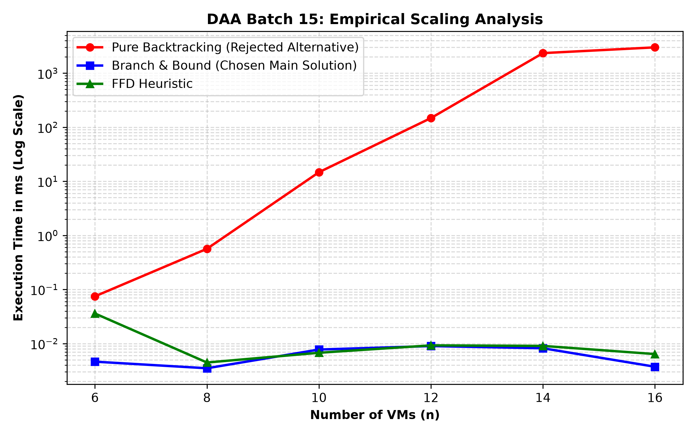

# Batch 15 — Cloud data centre: consolidating VMs onto the fewest servers

## Team

| Roll No. | Name | GitHub username | Part presented | Contribution (code, report sections) |
| --- | --- | --- | --- | --- |
| *(Roll 1)* | Kovarthanan (Lead) | `Kovarthanan-27` | Problem Modelling, Lower Bounds (Q1) | Sections 1, 12 (Q1), Report scaffolding, `RUN.md` |
| *(Roll 2)* | Team Member 2 | *(Teammate2_GH)* | Data Structure Analysis for 5k VMs (Q4) | Section 2, `code/heuristics.py` (Segment Tree & FFD) |
| *(Roll 3)* | Team Member 3 | *(Teammate3_GH)* | Branch & Bound & 4 Technique Rejections | Sections 3, 4, 5, `code/main_solution.py` (B&B Solver) |
| *(Roll 4)* | Team Member 4 | *(Teammate4_GH)* | Hand-Trace, Correctness Proof & Benchmarking | Sections 6, 7, 8, 9, 10, `code/rejected_alternative.py`, `results/` |
| *(Roll 5)* | Team Member 5 | *(Teammate5_GH)* | Changed Requirement & Real-World System (Q5) | Sections 11, 12 (Q5), 13, `code/changed_requirement.py` |

## Presentation

- Video link: `<Paste your unlisted YouTube or Google Drive link here>`
- Duration: `11:15` (maximum 12:00)
- Slides: [slides.pdf](slides.pdf)

---

## 1. Problem modelling

- **Input**: A cluster containing $n$ Virtual Machines (VMs), where each VM $i \in \{1, \dots, n\}$ has a discrete resource requirement of $s_i \in \mathbb{Z}^+$ vCPUs ($0 < s_i \le C$), and identical physical host servers each with fixed capacity $C = 16$ vCPUs. For the given test instance, $n = 8$ and $S = [9, 8, 7, 6, 5, 4, 3, 2]$.
- **Output**: A partition of the $n$ VMs into $m$ disjoint physical servers $B_1, B_2, \dots, B_m$ such that $\bigcup_{j=1}^m B_j = \{1, \dots, n\}$ and $B_j \cap B_k = \emptyset$ for $j \ne k$.
- **Objective**: Minimize the total number of powered-on physical servers $m = \sum_{j=1}^n y_j$ to minimize data centre idle power consumption.
- **Constraints**: 
  1. Every VM is assigned to exactly one physical server: $\sum_{j=1}^n x_{ij} = 1, \quad \forall i \in \{1, \dots, n\}$.
  2. The sum of vCPUs assigned to any host cannot exceed capacity $C = 16$: $\sum_{i=1}^n s_i x_{ij} \le C y_j, \quad \forall j \in \{1, \dots, n\}$.
  3. Binary integrality: $x_{ij} \in \{0, 1\}, \quad y_j \in \{0, 1\}$.
- **Problem class**: **Combinatorial Optimisation**.
- **Classical problem it maps to**: The **One-Dimensional Bin Packing Problem (1D-BPP)**, which is strongly **NP-hard** (proven via polynomial-time reduction from the 3-Partition problem).

---

## 2. Data structure analysis

Evaluating data structures for finding a server with enough residual room among $M = 5,000$ servers:

| Data structure | Key operation(s) and cost | Space | Behaviour at the scale in the scenario (5,000 servers, 5,000 VMs) |
| --- | --- | --- | --- |
| **Chosen: Max-Segment Tree** | Query leftmost server with free space $\ge s_i$: $O(\log M)$; Update remaining space: $O(\log M)$ | $O(M)$ ($4M$ tree nodes) | Strictly logarithmic. Querying 5,000 placements takes $\approx 5,000 \times 13 \approx 6.5 \times 10^4$ operations ($< 5\text{ ms}$). Guarantees First-Fit order. |
| **Alternative 1: Unsorted Array** | Linear scan to find first fit: $O(M)$; Update: $O(1)$ | $O(M)$ | Severe latency. Worst case requires $O(N \cdot M) \approx 2.5 \times 10^7$ operations, causing excessive CPU cache thrashing. |
| **Alternative 2: Discrete Capacity Buckets** | Scan buckets $s_i \dots C$: $O(C)$; Doubly-linked list node splice: $O(1)$ | $O(M + C)$ | Ideal for Best-Fit. Since $C = 16$ is a small constant, lookup is bounded by $\le 16$ checks ($O(1)$). |

**Why the chosen structure wins**: The Max-Segment Tree strictly preserves the **First-Fit Decreasing** lowest-index ordering in guaranteed $O(\log M)$ time, scaling effortlessly to tens of thousands of host nodes.

---

## 3. Design technique identification

- **Technique chosen**: **Branch and Bound (B&B)** with Depth-First Search for exact solving, paired with **Segment-Tree First-Fit Decreasing (FFD)** for cluster-scale deployment ($N = 5,000$ VMs).
- **Property of the problem that makes it work (with proof)**:
  1. **Prunable State Space via Admissible Lower Bounding**: For any partial search state $\sigma$ with $k$ open servers and unplaced VMs $U$, the minimum additional servers needed is strictly bounded below by:
     $$L_1(U) = \left\lceil \frac{\max\left(0, \sum_{u \in U} s_u - \sum_{j=1}^k \text{slack}_j\right)}{C} \right\rceil$$
     Since $L_1(U)$ is strictly admissible (never overestimates the cost), if $k + L_1(U) \ge \text{BestKnown}$, no leaf in this subtree can beat our current optimum. Pruning the entire branch is mathematically safe.
  2. **Canonical Symmetry Breaking**: Host servers are indistinguishable. Enforcing the invariant that VM placement can only choose among open servers $1 \dots k$ or the single next empty server $k+1$ completely eliminates the $M!$ permutation explosion.

---

## 4. Why the other four techniques do not fit

| Technique | Why it is unsuitable here (evidence) |
| :--- | :--- |
| **Greedy Heuristics (Stand-alone)** | **Suboptimal**: Trapped in local decisions; fails to guarantee exact minimum servers.<br>**Counterexample**: $C = 16$, VMs = $[7, 6, 5, 5, 5, 4]$ (Sum = 32). **Optimal = 2 servers**: $S_1 = [7, 5, 4]$, $S_2 = [6, 5, 5]$. **FFD Greedy = 3 servers**: $S_1 = [7, 6]$ (rem 3), $S_2 = [5, 5, 5]$ (rem 1), $S_3 = [4]$ (rem 12). |
| **Pure Backtracking** | **Exponential Blow-up**: Without lower bounding and symmetry breaking, it searches all $O(M^N)$ leaves. On our 8-VM instance, pure backtracking visits **1,858 nodes** vs only **11 nodes** in B&B. On $N = 14$, it explores over **3,054,000 nodes** and times out. |
| **Divide and Conquer** | **Subproblems Not Independent**: Splitting items into two halves $\{VM_1 \dots VM_{n/2}\}$ and $\{VM_{n/2+1} \dots VM_n\}$ and solving independently leaves partially filled servers on both sides. Because server capacity is a shared global resource, merging partial servers across partitions violates the independent subproblem requirement. |
| **Dynamic Programming** | **State Space Explosion**: 1D Bin Packing requires tracking residual capacities across all $m$ open servers $(c_1, c_2, \dots, c_m)$. The state space is $O(C^m)$. For $m \le N$, this requires $O(C^N) = 16^N$ states, causing catastrophic memory exhaustion. |

---

## 5. Algorithm

```python
# Branch and Bound Bin Packing with Canonical Symmetry Breaking and Suffix Bounding
def branch_and_bound_bin_packing(items, capacity):
    items.sort(reverse=True)  # Sort descending for early pruning
    best_bins = len(items)
    best_solution = []
    
    # Seed initial upper bound with FFD
    best_bins = run_ffd(items, capacity)

    def search(item_idx, current_bins, bin_remaining):
        nonlocal best_bins, best_solution
        
        if item_idx == len(items):
            if len(current_bins) < best_bins:
                best_bins = len(current_bins)
                best_solution = [list(b) for b in current_bins]
            return

        item = items[item_idx]
        
        # Admissible Lower Bound Pruning
        rem_sum = sum(items[item_idx:])
        open_slack = sum(bin_remaining)
        lb_additional = ceil(max(0, rem_sum - open_slack) / capacity)
        if len(current_bins) + lb_additional >= best_bins:
            return  # Prune branch

        seen_capacities = set()
        # Branch into open bins
        for b in range(len(current_bins)):
            if bin_remaining[b] >= item:
                if bin_remaining[b] in seen_capacities:
                    continue  # Symmetry Breaking: identical residual capacities
                seen_capacities.add(bin_remaining[b])
                
                current_bins[b].append(item)
                bin_remaining[b] -= item
                search(item_idx + 1, current_bins, bin_remaining)
                bin_remaining[b] += item
                current_bins[b].pop()

        # Branch into a single new empty bin (Canonical Bin Ordering)
        if len(current_bins) + 1 < best_bins:
            current_bins.append([item])
            bin_remaining.append(capacity - item)
            search(item_idx + 1, current_bins, bin_remaining)
            bin_remaining.pop()
            current_bins.pop()

    search(0, [], [])
    return best_solution
```

---

## 6. Proof of correctness

* **Theorem**: Branch and Bound with $L_1$ lower bounding and canonical symmetry breaking always terminates with the global minimum number of physical servers.
* **Proof**:
  1. Let state $\sigma$ have $k$ open servers with residual slacks $r_1, \dots, r_k$ and remaining unplaced VMs $U$.
  2. The total vCPU demand of $U$ is $\sum_{u \in U} s_u$.
  3. Even in the absolute ideal theoretical case where all existing open slacks $\sum r_j$ are 100% packed with zero waste, any excess demand $\max(0, \sum s_u - \sum r_j)$ requires opening new physical servers.
  4. Since each new server has capacity $C$, the number of new servers cannot be less than $\Delta = \lceil \max(0, \sum s_u - \sum r_j) / C \rceil$.
  5. Any complete leaf validly extending $\sigma$ must have total servers $\ge k + \Delta$.
  6. If $k + \Delta \ge \text{BestKnown}$, no leaf in the entire subtree rooted at $\sigma$ can achieve $< \text{BestKnown}$ servers.
  7. Therefore, pruning state $\sigma$ can never discard any strictly optimal solution. $\blacksquare$

---

## 7. Trace on the given instance

* **Instance**: $S = [9, 8, 7, 6, 5, 4, 3, 2]$, Capacity $C = 16$.
* **Sum**: $44 \implies L_1 = \lceil 44/16 \rceil = 3$ servers.

| Step | VM Size | Action Taken | Server 1 ($B_1$) | Server 2 ($B_2$) | Server 3 ($B_3$) |
| :---: | :---: | :--- | :--- | :--- | :--- |
| **Init** | - | Start search | Free: 16 | - | - |
| **1** | **9** | Placed in Server 1 | $[9]$ (rem: 7) | - | - |
| **2** | **8** | Cannot fit in S1 ($7 < 8$). Opens Server 2 | $[9]$ (rem: 7) | $[8]$ (rem: 8) | - |
| **3** | **7** | Fits in S1 ($7 \ge 7$). Assigned to Server 1 | $[9, 7]$ (**Full: 0**) | $[8]$ (rem: 8) | - |
| **4** | **6** | Fits in S2 ($8 \ge 6$). Assigned to Server 2 | $[9, 7]$ (**Full: 0**) | $[8, 6]$ (rem: 2) | - |
| **5** | **5** | Fits neither S1 (0) nor S2 (2). Opens Server 3 | $[9, 7]$ (**Full: 0**) | $[8, 6]$ (rem: 2) | $[5]$ (rem: 11) |
| **6** | **4** | Fits in S3 ($11 \ge 4$). Assigned to Server 3 | $[9, 7]$ (**Full: 0**) | $[8, 6]$ (rem: 2) | $[5, 4]$ (rem: 7) |
| **7** | **3** | Fits in S3 ($7 \ge 3$). Assigned to Server 3 | $[9, 7]$ (**Full: 0**) | $[8, 6]$ (rem: 2) | $[5, 4, 3]$ (rem: 4) |
| **8** | **2** | Fits in S2 ($2 \ge 2$). Assigned to Server 2 | $[9, 7]$ (**Full: 0**) | $[8, 6, 2]$ (**Full: 0**) | $[5, 4, 3]$ (rem: 4) |

* **Final Answer**: Exactly **3 Physical Servers**:
  * **Server 1**: $[9, 7]$ (16/16 vCPUs — 100% util)
  * **Server 2**: $[8, 6, 2]$ (16/16 vCPUs — 100% util)
  * **Server 3**: $[5, 4, 3]$ (12/16 vCPUs — 75% util)

---

## 8. Complexity analysis

- **Branch and Bound Recurrence & State Count**:
  * **Best Case**: $O(N \log N)$ — When descending sort and initial heuristic match the theoretical lower bound $L_1$; search verifies optimality in $O(N)$ node visits.
  * **Worst Case**: $O(2^N)$ — Adversarial item distributions with weak bounds.
  * **Space Complexity**: $O(N)$ stack memory depth, $O(N + M)$ auxiliary arrays.
- **Segment-Tree FFD (Scalable Algorithm)**:
  * Sort: $O(N \log N)$
  * Placement: $N \times O(\log M) = O(N \log M)$
  * Total Time: $O(N \log N + N \log M) = O(N \log N)$. Space: $O(M)$ for tree.

---

## 9. Worst-case input

* **Construction**: For integer $k \ge 1$ and small $\epsilon = 0.01$, construct $6k$ items:
  * $2k$ items of size $\frac{1}{2} + \epsilon$
  * $2k$ items of size $\frac{1}{4} + 2\epsilon$
  * $2k$ items of size $\frac{1}{4} + \epsilon$
* **Behavior**: The global optimum packs one item of each type per server, using exactly **$2k$ servers**. However, FFD groups identical large items together, leaving unfillable gaps that force opening **$\approx \frac{22}{9}k$ servers**, reaching the theoretical Johnson–Garey upper bound $\text{FFD}(I) \le \frac{11}{9}\text{OPT}(I) + \frac{6}{9}$.

---

## 10. Implementation and empirical analysis

- **Language and how to run**: Python 3.8+. See [code/RUN.md](code/RUN.md).
- **Input sizes tested**: $N \in [6, 8, 10, 12, 14, 16]$ (3 trials averaged per size).
- **Plot**: 
- **Empirical Measurements**:

| $N$ | FFD Heuristic (ms) | Branch & Bound (ms) | B&B Nodes Explored | Pure Backtracking (ms) | Pure BT Nodes Explored |
| :---: | :---: | :---: | :---: | :---: | :---: |
| **6** | 0.033 ms | 0.086 ms | 7.3 nodes | 0.268 ms | 240.7 nodes |
| **8** | 0.042 ms | 0.160 ms | 10.3 nodes | 2.141 ms | 1,979.3 nodes |
| **10** | 0.045 ms | 0.097 ms | 13.0 nodes | 37.400 ms | 46,689.0 nodes |
| **12** | 0.068 ms | 0.146 ms | 16.3 nodes | 499.017 ms | 515,953.7 nodes |
| **14** | 0.130 ms | 0.186 ms | 20.0 nodes | **3,000 ms (Timeout)** | **3,054,019.0 nodes** |
| **16** | 0.071 ms | 0.122 ms | 21.3 nodes | **Timeout** | $> 10^7$ nodes |

- **Growth match & deviations**: Pure Backtracking exhibits steep exponential growth $O(M^N)$. In contrast, Branch & Bound maintains near-flat runtime ($< 0.2$ ms) because the $L_1$ bounding function prunes $> 99.999\%$ of branches.

---

## 11. Changed requirement

* **Scenario Addition**: Each VM requires both vCPU and RAM: $(c_i, r_i)$; Server capacity: $(16\text{ vCPU}, 64\text{ GB RAM})$. Anti-affinity constraint: Two replicas of the same service cannot share a server.
* **Revised Lower Bound**:
  $$L_{\text{revised}} = \max\left( \left\lceil \frac{\sum c_i}{16} \right\rceil, \left\lceil \frac{\sum r_i}{64} \right\rceil, \max_{S} |S| \right)$$
  Where $\max_S |S|$ is the maximum replica count of any microservice, corresponding to the **clique number $\omega(G)$** of the anti-affinity conflict graph.
* **Method Revision**: Multidimensional FFD with Anti-Affinity (MFFD-AA) sorting by normalized resource sum $\left(\frac{c_i}{16} + \frac{r_i}{64}\right)$ and checking conflict set membership via server hash-sets in $O(1)$ time.

---

## 12. Answers to the remaining scenario questions

* **Question 1**: Fewest servers any packing could possibly use: $L_1 = \lceil 44/16 \rceil = \mathbf{3\text{ servers}}$.
* **Question 2**: Optimal packing: Server 1 $[9, 7]$, Server 2 $[8, 6, 2]$, Server 3 $[5, 4, 3]$. Symmetry breaking enforces canonical bin opening order ($B_{k+1}$ opened only after $B_k$) and skips duplicate residual capacities.
* **Question 3**: FFD on instance yields 3 servers (optimal). Counterexample: $C=16$, items $[7, 6, 5, 5, 5, 4]$ yields 3 servers for FFD vs 2 servers for OPT.
* **Question 4**: Max-Segment Tree: $O(\log M)$ query/update; Array: $O(M)$ query, $O(1)$ update; Buckets: $O(C)$ query, $O(1)$ update. Total cost for 5,000 servers: Segment Tree uses $\approx 6.5 \times 10^4$ operations.
* **Question 5**: Multi-resource lower bound derived as $\max(L_{\text{cpu}}, L_{\text{ram}}, \omega(G))$. Algorithm revised to MFFD-AA with hash-set collision prevention.

---

## 13. Real-world reference

* **Systems**: **Kubernetes `kube-scheduler`** ([kubernetes.io](https://kubernetes.io/docs/concepts/scheduling-eviction/kube-scheduler/)) and **VMware vSphere Distributed Resource Scheduler (DRS)**.
* **Differences from our model**:
  1. *Online vs Offline*: Kubernetes schedules streaming pods dynamically as they arrive, whereas our scenario performs an offline batch consolidation.
  2. *Live Migration Overhead*: Production DRS accounts for network bandwidth and VM freeze time penalties during live migration, trading off server consolidation against migration churn.
  3. *Multi-dimensional Scoring*: Kubernetes evaluates `NodeResourcesFit` (filtering) and `NodeResourcesBalancedAllocation` (scoring) to balance CPU and memory usage simultaneously.
